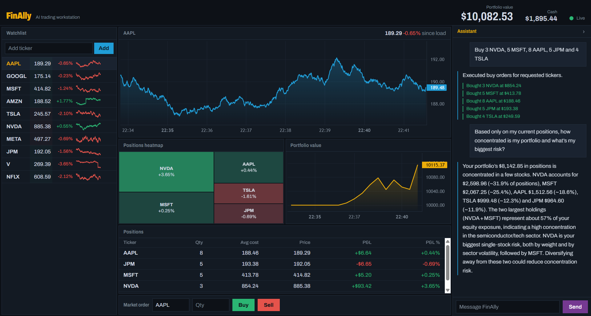

# FinAlly — the Finance Ally

An AI-powered trading workstation: live market data, a simulated $10,000 portfolio, and an AI chat assistant that can analyze your positions and trade on your behalf. Think Bloomberg terminal with an AI copilot.

FinAlly is built by coding agents that coordinate through the specs in [`planning/`](planning/PLAN.md). Based on Ed Donner's FinAlly course project.



> **Status:** feature-complete. Backend (135 tests), frontend (18 tests) and the Playwright E2E suite (8 scenarios, run against a fresh Docker container) all pass. Built by an agent team; see [`planning/TEAM.md`](planning/TEAM.md).

## Features

- Live prices streamed over SSE, with green/red flashes and sparklines
- Market orders with instant fills, no fees
- Portfolio heatmap, P&L chart and positions table
- AI chat that can explain your portfolio, place trades and edit your watchlist
- Built-in market simulator by default; real data with a Massive (Polygon.io) key

## Stack

| Layer | Tech |
|---|---|
| Frontend | Next.js 16 + React 19 + TypeScript (static export), Tailwind 4, Lightweight Charts 5 |
| Backend | FastAPI on Python 3.13, managed with `uv` |
| Database | SQLite |
| AI | LiteLLM → Groq (`gpt-oss-120b`), OpenRouter free-model fallback |
| Deployment | Single Docker container on port 8000 |
| Tests | pytest, Vitest + React Testing Library, Playwright |

## Run

Requires Docker.

1. Copy `.env.example` to `.env` and set `GROQ_API_KEY` and/or `OPENROUTER_API_KEY` (or `LLM_MOCK=true`).
2. Start the app (builds the image on first run; add `--build` / `-Build` to rebuild):
   ```bash
   ./scripts/start_mac.sh        # macOS / Linux
   ./scripts/start_windows.ps1   # Windows PowerShell
   ```
3. Open http://localhost:8000.

Stop with `scripts/stop_mac.sh` or `scripts/stop_windows.ps1`. Data is kept in the `finally-data` Docker volume; `docker volume rm finally-data` resets it.

## Configuration

| Variable | Purpose |
|---|---|
| `GROQ_API_KEY` | Primary LLM provider |
| `OPENROUTER_API_KEY` | Fallback LLM provider |
| `MASSIVE_API_KEY` | Optional real market data; leave empty to use the simulator |
| `MASSIVE_POLL_INTERVAL` | Seconds between Massive polls (default 15, free-tier safe) |
| `LLM_MOCK` | `true` returns canned LLM replies (for tests, no key needed) |

## Development

### Backend

Requires [uv](https://docs.astral.sh/uv/). From `backend/`:

```bash
uv sync                                    # install dependencies, including test tools
uv run pytest                              # run the unit tests
uv run uvicorn app.main:app --port 8000    # run the API (serves ../frontend/out if built)
uv run market_data_demo.py                 # live price table in the terminal (Ctrl+C to quit)
```

Set `FINALLY_DB_PATH` to use a different SQLite file (default `db/finally.db`). The demo uses the simulator, or Massive when `MASSIVE_API_KEY` is set in `.env`; add `--seconds 20` to stop it automatically.

### Frontend

Requires Node 24. From `frontend/`:

```bash
npm ci
npm run dev      # dev server; proxies /api to http://localhost:8000
npm test         # Vitest unit tests
npm run build    # static export to frontend/out
```

### E2E tests

Run a fresh container with `LLM_MOCK=true`, then the Playwright suite:

```bash
docker build -t finally .   # from the repo root
docker run -d --name finally-e2e -v finally-e2e-data:/app/db -p 8000:8000 -e LLM_MOCK=true finally
cd test && npm ci && npx playwright install chromium && npx playwright test
```

Set `BASE_URL` to test another address. Remove the container and volume afterwards.

## Project layout

```
frontend/   Next.js app
backend/    FastAPI app (uv project): market data, db, portfolio, chat
planning/   Specs shared by the agents
scripts/    Start/stop scripts
test/       Playwright E2E tests
db/         SQLite file for local runs
```

## License

MIT, see [LICENSE](LICENSE).
